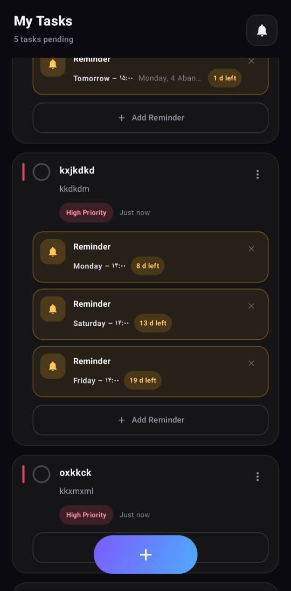
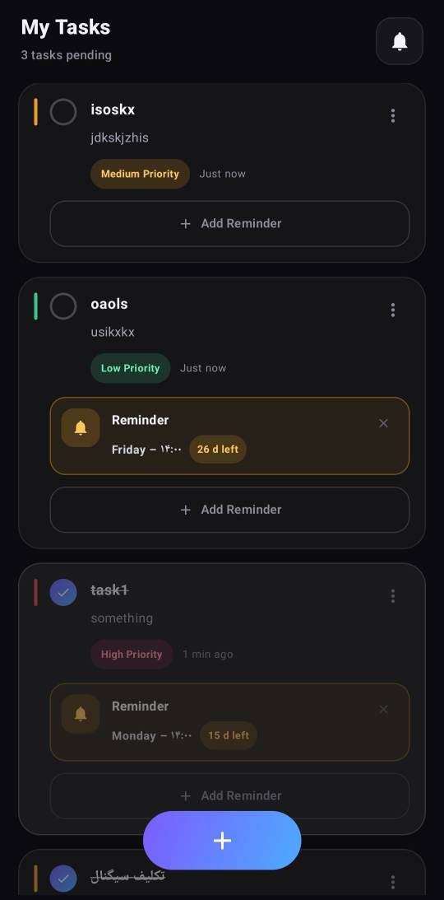
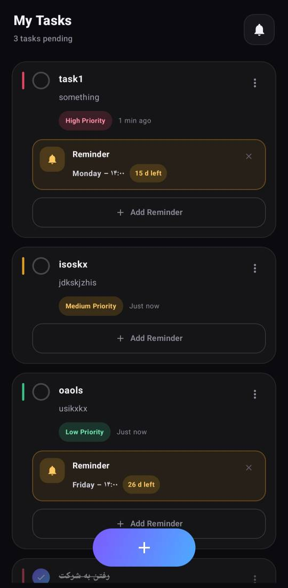
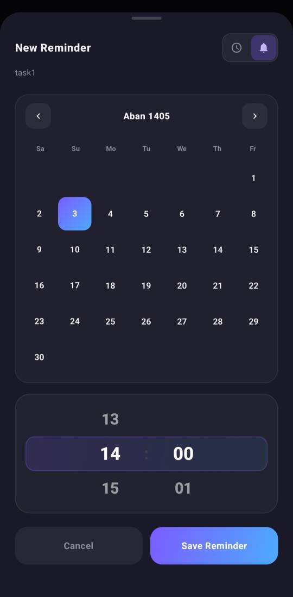
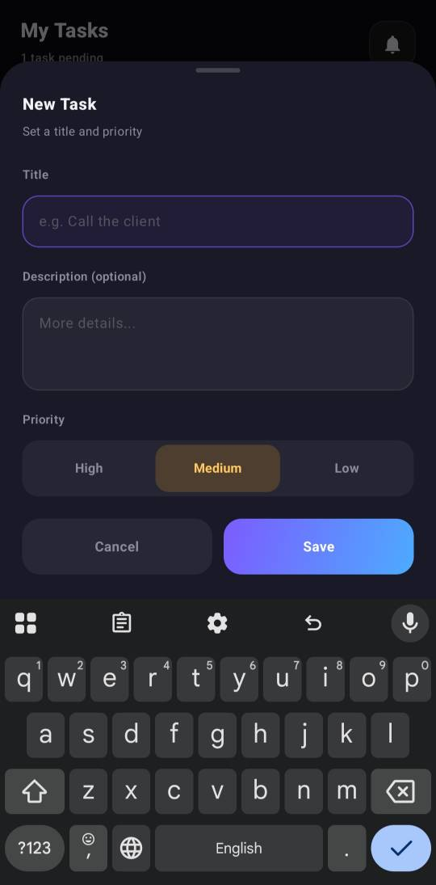

# Task Manager

An offline Android task manager built around the Jalali calendar. Tasks carry priorities, reminders, and a completion state, all stored locally on the device. Nothing leaves the phone.

The app exists because most task managers either ignore the Persian calendar or bury reminders under three menus. This one shows the calendar first and lets you pick the exact minute a reminder should fire.

## What it does

- Create tasks with a title, optional description, and a three-level priority (High, Medium, Low).
- Attach one or more reminders to any task. Each reminder is independent.
- Choose how each reminder fires: as a full-screen alarm with sound and vibration, or as a quiet notification.
- See reminders on a Jalali calendar with the correct number of days per month.
- Track completion separately from reminder state. Dismissing an alarm does not mark the task done.

## Screenshots











## How it works

The app has three layers.

**UI (Jetpack Compose)** renders the task list, the editors, and the Jalali calendar. Every screen is built from composables in a single source file.

**TaskViewModel** holds the in-memory list of tasks and exposes it as a `StateFlow`. Every edit goes through it.

**TaskStorage** serializes tasks to `filesDir/tasks.json` using `kotlinx.serialization`. There is no database and no cloud sync. A task lives on one device until the user uninstalls the app.

Reminders are scheduled through `AlarmManager`. When a reminder fires, a `BroadcastReceiver` shows either a full-screen alarm or a standard notification, depending on the mode the user picked. A second receiver reschedules all pending reminders after the device reboots.

The Jalali calendar is ported from [jalaali-js](https://github.com/jalaali/jalaali-js) and included directly in the source. No external date library is used.

## Tech stack

| Component | Version |
|---|---|
| Language | Kotlin 2.0.0 |
| Build | Android Gradle Plugin 8.5.2 |
| UI | Jetpack Compose (BOM 2024.06.00) |
| Persistence | kotlinx.serialization 1.6.3 |
| Min SDK | 26 (Android 8.0) |
| Target SDK | 34 (Android 14) |

## Building

Requires JDK 17 and the Android SDK. Gradle is handled by the wrapper.

```
git clone <repo-url>
cd task-manager
./gradlew assembleDebug
```

The APK lands at `app/build/outputs/apk/debug/app-debug.apk`.

Every push to `main` also builds a debug APK in GitHub Actions and uploads it as an artifact. Look under the Actions tab.

## Installing

Download the latest APK from the Actions tab, enable "Install from unknown sources" for your file manager, and open the file.

For the app to deliver reminders reliably on phones with aggressive battery management (Xiaomi, Huawei, Oppo), two extra steps are needed:

1. Set the app's battery usage to "Unrestricted" in system settings.
2. Enable "Autostart" for the app if the manufacturer exposes that toggle.

Without these, the operating system may delay or suppress alarms when the screen has been off for a while.

## Permissions

| Permission | Why it is needed |
|---|---|
| `POST_NOTIFICATIONS` | Required on Android 13+ to show any reminder |
| `SCHEDULE_EXACT_ALARM` | Lets reminders fire at the exact minute, not within a window |
| `USE_EXACT_ALARM` | Alternate path for Android 14+ |
| `VIBRATE` | Pattern used when a reminder fires |
| `RECEIVE_BOOT_COMPLETED` | Reschedules pending reminders after reboot |
| `WAKE_LOCK` | Wakes the device briefly when an alarm fires |

No network permission is requested. The app cannot send data anywhere.

## Project structure

```
app/
├── src/main/
│   ├── AndroidManifest.xml
│   ├── java/com/example/taskmanager/
│   │   └── MainActivity.kt
│   └── res/
│       ├── values/
│       ├── drawable/
│       └── mipmap-anydpi-v26/
├── build.gradle.kts
└── proguard-rules.pro
```

All application code lives in `MainActivity.kt`. This was a deliberate choice: the project is small enough that a single file is easier to navigate than a package tree, and it makes the whole app readable in one scroll. If the app grows past a few thousand lines, splitting it becomes worthwhile.

## Known behavior

- Exact alarms require the `SCHEDULE_EXACT_ALARM` permission on Android 12+. If the user denies it, reminders fall back to inexact scheduling and may arrive a few minutes late.
- Notification permission on Android 13+ is requested on first launch. If denied, reminders still fire but stay silent.
- Reminders already fired before the app opens are marked as dismissed and are not shown again.

## License

MIT. See [LICENSE](LICENSE).

## Credits

Jalali calendar conversion based on [jalaali-js](https://github.com/jalaali/jalaali-js). Icons from Material Symbols.
